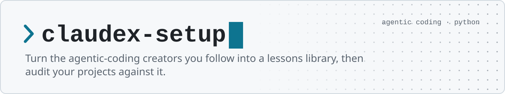
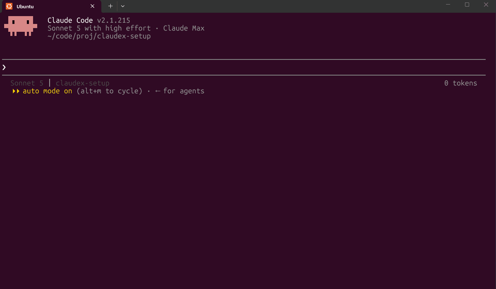
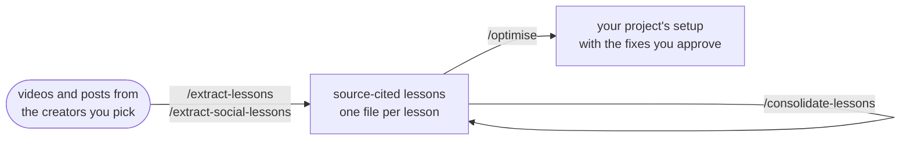

<div align="center">

<picture>
  <source media="(prefers-color-scheme: dark)" srcset=".github/readme/banner_dark.svg">
  
</picture>

[Quickstart](#quickstart-60-seconds) · [Learn from creators](#learn-from-the-creators-you-pick) · [Commands](#everything-you-can-run) · [Customising](#customising-for-your-stack) · [Contributing](#contributing-layout--versioning)

[](https://github.com/model-bender/claudex-setup/actions/workflows/validate.yml)
[](LICENSE)

</div>

Turn the agentic-coding creators you follow into a lessons library your agent uses,
then audit your real projects against it, across [Claude Code](https://claude.com/claude-code)
and [Codex](https://developers.openai.com/codex/).

You watch the tutorials, read the threads, star the gists, and the best tips evaporate.
`claudex-setup` is a config you run yourself: it mines those tips into **source-cited lessons
from the creators *you* pick**, curates them, and audits your projects against them, alongside
a battle-tested set of slash commands, subagents, and hooks.



Keep it as a **standalone repo alongside your projects**: you run it *from* here, and
`/optimise` improves your other projects' agent setups in place. You don't install it into each
repo.

> [!NOTE]
> **Why "claudex"?** **Claude** Code + Co**dex**. `/optimise` audits whichever agent tools a
> project uses: Claude Code by default, Claude Design with `--design`, OpenAI Codex
> with `--codex`, keeping one tracker per tool. Working in this repo with Codex? Start at
> [`AGENTS.md`](AGENTS.md), which holds the rules both tools share; [`CLAUDE.md`](CLAUDE.md)
> imports it and adds the Claude-Code-only ones.
>
> **Scope:** the lessons library is **Claude-Code-first** (it also mines a Codex/OpenAI
> voice cluster, keeping what transfers to general agentic coding), and the commands, subagents,
> and hooks are Claude Code artifacts. Codex is first-class in what this repo **audits and
> tracks**, not a claim of tool parity.

## Quickstart (60 seconds)

**Requirements:** Claude Code, [`uv`](https://docs.astral.sh/uv/), Python >=3.14 (uv fetches it).

```bash
git clone https://github.com/model-bender/claudex-setup
cd claudex-setup && uv sync     # then open Claude Code here
```

```text
/extract-lessons            # mine your tracked creators into a lessons library
/optimise <your-project>    # audit another project's setup against those lessons, apply fixes
```

The full walkthrough is in [`USER_GUIDE.md`](USER_GUIDE.md). Prefer the commands available
*inside* another repo? It's also a plugin: `/plugin install claudex-setup --marketplace model-bender/claudex-setup` (one step, Claude Code 2.1.275 or later), or `/plugin marketplace add model-bender/claudex-setup` first.

## Learn from the creators you pick



Most configs "improve themselves" from your own sessions. This one learns from the
practitioners you trust:

1. **Pick your sources**: drop creator video URLs in `transcripts/urls.txt`, or add voices
   to [`references/agentic-coding-voices.md`](references/agentic-coding-voices.md).
2. **Mine them**: `/extract-lessons` (YouTube transcripts) or `/extract-social-lessons`
   (X, blog and Reddit posts, via a research subagent team) distil them into one-file-per-lesson markdown,
   each citing its source.
3. **Curate + apply**: `/consolidate-lessons` keeps the library lean; `/optimise <project>`
   audits a project's setup against it and applies the fixes you approve.

> **Example:** point it at Boris Cherny and Simon Willison and you get lessons like *"pre-compute
> context with inline bash in slash commands"* and *"clone a reference repo to /tmp"*, each
> linked to the post it came from. Browse [`lessons/INDEX.md`](lessons/INDEX.md) to see over
> 1,200 already mined.

<details>
<summary><b>About YouTube transcripts</b></summary>
<br>

YouTube has no official way to download captions for videos you don't own: its API's caption
download [requires permission to edit the video](https://developers.google.com/youtube/v3/docs/captions/download).
So the fetcher uses the community
[`youtube-transcript-api`](https://github.com/jdepoix/youtube-transcript-api) library, which
reads the same captions the YouTube player shows. It's unofficial, and YouTube's
[Terms of Service](https://www.youtube.com/t/terms) restrict automated access, so treat the
fetcher as a personal tool: use it for your own learning, keep runs small, and use it at your
own discretion.

To keep that footprint small, the fetcher makes ordinary requests, waits a few seconds between
videos, fetches at most 40 new transcripts a run, and stops after three blocked requests. Run
it again later and it picks up where it stopped.

Transcripts are never published (the public repo ships without `transcripts/`). Only lessons
ship, and those are short summaries that cite their source. To skip automated fetching
entirely, open the video on YouTube, click **Show transcript** below the description, and paste
the text into a `.txt` file under `transcripts/<creator>/`. Put
`# URL: https://www.youtube.com/watch?v=<id>` on its first line, so lessons can cite it and the
fetcher knows it's already done. Then run `/extract-lessons`.

</details>

## Everything you can run

| Run… | …to |
|------|-----|
| `/extract-lessons` | mine Claude Code tips from YouTube transcripts you fetch |
| `/extract-social-lessons` | mine tips from practitioner posts (X, blogs, Reddit) via a research subagent team |
| `/discover` | catalogue the tools, repos and projects people use alongside Claude Code and Codex, from your transcripts, each checked against GitHub or its site |
| `/consolidate-lessons` | merge duplicate lessons and prune the archive |
| `/optimise <project>` | audit a project's setup against your lessons and apply fixes one at a time (`--design` audits Claude Design, `--codex` audits OpenAI Codex) |
| `/top-tips [n]` | rank the high-value lessons you never adopted and offer the top few |
| `/changelog-claude` | triage every Claude Code release since the last run against your global setup and apply what you approve |
| `/changelog-codex` | the same for Codex CLI releases and the OpenAI Codex changelog |
| `/weekly-update` | run the whole weekly pass (fetch, mine and consolidate lessons, both changelogs, every project audit, top tips) and answer every decision on one sheet |
| `/review-pr` | multi-agent review of a pull request |
| `/claude-loop` | have a fresh Claude session review the repo (or one branch), fix what it finds, and loop until each area comes back clean twice |
| `/codex-loop` | the same loop on Codex: its bigger model reviews and its smaller model writes the fixes |
| `/test [suite]` | run the project's tests / lint / build |
| `/pr`, `/ticket` | GitHub PR + Jira ticket flow [†](#pr-ticket-note) |
| `/fact-check` | verify claims in content against real sources |
| `/quiz-me` | review an agent-written change by being examined on it: it quizzes you on the diff, diagrams what moved, and turns the questions you cannot answer into the review findings |
| `/revise-claude-md` | update `CLAUDE.md` with learnings from this session |
| `/ralph-loop <prompt>` | start a Ralph Loop, an iterative self-referential development loop |
| `/cancel-ralph` | cancel an active Ralph Loop |
| `/ralph-help` | explain the Ralph Loop and its commands |

<a id="pr-ticket-note"></a>† `/pr` needs the `gh` CLI, and `/ticket` needs the Jira MCP server (see [`.mcp.json.example`](.mcp.json.example)). Neither is **bundled in the plugin**, but both are available when you run the repo as a hub with those tools set up.

Plus subagents (`code-reviewer`, `qa`, `backend-dev`, `frontend-dev`, `code-simplifier`,
`pr-test-analyzer`, `qa` restricted to Read, Bash, Glob and Grep), lifecycle hooks (an advisory security
reminder, a guard that blocks destructive git pushes, a portable auto-formatter, GSD statusline/context-monitor/update-check), and skills
(`claude-md-improver`, `frontend-design`, `session-handoff`).

## Customising for your stack

The defaults lean toward a `backend/` (Python + `uv`) + `frontend/` (Node) layout, but the
commands read your project's real commands from `CLAUDE.md`, so it adapts. Tune `CLAUDE.md`
(your commands + conventions), `settings.json` (tool/secret rules), `hooks/auto-format.sh`
(formatters), and `agents/` (roles).

## Using it inside another project (advanced)

If you do want the config *in* a specific repo (via the plugin, or by copying it into `.claude/`):

- **The repo must become the `.claude/` folder itself**: `settings.json` references hooks as
  `.claude/hooks/…`, so copying it into a subfolder silently breaks them.
- **`settings.json` does not cascade**: each project needs its own copy.
- **Verify with `/hooks`** after copying. A single JSON typo in `settings.json` silently
  disables all hooks; the `validate` CI workflow catches malformed config.
- `settings.local.json` is gitignored (personal/machine overrides); shareable rules go in `settings.json`.

## Contributing, layout & versioning

Contributions welcome, see [`CONTRIBUTING.md`](CONTRIBUTING.md). Directory tree:
[`references/project-structure.md`](references/project-structure.md). Changes are logged in
[`CHANGELOG.md`](CHANGELOG.md); releases are tagged `vX.Y.Z`.

Among its other checks, the `validate` workflow runs these on every push to `main` and every pull request:

```bash
python3 scripts/validate-artifacts.py     # agent, skill and command frontmatter and the plugin manifests
uv run --with pytest pytest -q tests/     # pipeline unit tests
```

---

<div align="center">
<sub><a href="LICENSE">MIT licensed</a> · sibling of <a href="https://github.com/model-bender/claudex-learn">claudex-learn</a></sub>
</div>
